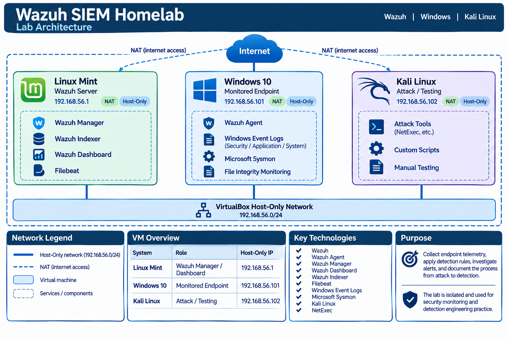

# Wazuh SIEM Homelab

A hands-on Wazuh SIEM homelab focused on Windows endpoint monitoring, detection engineering, and security investigations.

This project demonstrates how endpoint activity can be generated in a controlled virtual environment, collected through Wazuh and Sysmon, detected using built-in and custom Wazuh rules, and investigated through security event data and alert evidence.

The project includes individual attack simulations, custom detection logic, investigation walkthroughs, and a capstone investigation that brings together the techniques explored throughout the lab.

## Architecture

The lab consists of three systems connected through a VirtualBox Host-Only network.



| System     | Role                                              | Host-Only IP     |
| ---------- | ------------------------------------------------- | ---------------- |
| Linux Mint | Wazuh Manager, Indexer, and Dashboard             | `192.168.56.1`   |
| Windows 10 | Monitored endpoint running Wazuh Agent and Sysmon | `192.168.56.101` |
| Kali Linux | Attack and testing system                         | `192.168.56.102` |

## Lab Components

### Wazuh Server — Linux Mint

The Wazuh server runs on the physical Linux Mint host and provides:

- Wazuh Manager
- Wazuh Indexer
- Wazuh Dashboard
- Filebeat

The Wazuh Manager receives endpoint telemetry, processes events using the configured ruleset, and generates alerts when activity matches detection rules.

### Windows Endpoint

The Windows 10 virtual machine is the monitored endpoint.

The Wazuh Agent collects telemetry from several sources:

- Windows Security events
- Windows Application events
- Windows System events
- Microsoft Sysmon events
- File Integrity Monitoring
- System inventory and security configuration data

Sysmon provides detailed process and system activity that supports investigation of suspicious execution and other endpoint behavior.

### Kali Linux — Testing System

Kali Linux is used to generate controlled activity against the Windows endpoint.

Tools used in the documented exercises include:

- NetExec for SMB authentication testing
- Standard Linux command-line utilities

All testing is performed against the isolated lab environment.

## Detection and Investigation Workflow

The project follows endpoint activity from generation through telemetry collection, detection, and investigation.

1. Controlled activity is generated from the testing system or Windows endpoint.
2. Windows records relevant Security or Sysmon events.
3. The Wazuh Agent collects and forwards endpoint telemetry.
4. The Wazuh Manager evaluates events against its ruleset.
5. Built-in and custom rules generate alerts.
6. Alert details and underlying event data are investigated in the Wazuh Dashboard.

The project uses built-in Wazuh rules where they provide suitable detection coverage. Custom rules are added where additional detection logic is needed.

### Custom Detection

The project includes custom rule `100100`, which detects repeated SMB authentication failures by correlating multiple failed logon events within a defined time window.

The rule complements Wazuh's built-in authentication detections. It is specifically intended to identify repeated SMB authentication failures; it does not represent a cross-event detection covering every stage of the capstone investigation.

Custom rules are maintained separately from the default Wazuh ruleset in:

`detections/local_rules.xml`

## Attack Simulations and Investigations

The `attacks/` directory contains documentation for the individual attack simulations and the final capstone investigation.

The exercises cover:

- **SMB brute-force activity:** Repeated failed SMB authentication attempts against the Windows endpoint, with Wazuh detection through built-in and custom rules.
- **Encoded PowerShell execution:** Execution of a harmless Base64-encoded PowerShell command, monitored through Sysmon process creation telemetry.
- **Local account creation:** Creation of a temporary local Windows account and investigation of the associated Security event.
- **Local Administrators group modification:** Addition of the temporary account to the local Administrators group and investigation of the privilege change.
- **Capstone investigation:** An end-to-end investigation bringing together the previously explored activity, including SMB authentication failures, account creation, privilege modification, encoded PowerShell execution, and scheduled task registration.

The capstone investigation uses the collected event data to reconstruct the sequence of observed activity, correlate related events, and distinguish confirmed evidence from assumptions about causality.

All exercises are performed against intentionally configured virtual machines within the isolated lab network.

## Detection Engineering

Detection-related configuration is maintained in the `detections/` directory.

The project uses Wazuh's existing rules as a starting point and adds local rules where additional detection logic is required.

Detection logic is designed to be:

- Based on observable endpoint telemetry
- Reproducible within the lab
- Specific to the activity being monitored
- Maintained separately from the default Wazuh ruleset
- Documented alongside the relevant attack simulation and investigation

## Evidence

The `evidence/` directory contains supporting material collected during the exercises and investigations.

Evidence includes:

- Terminal output from the testing system
- Windows Security event details
- Sysmon event data
- Wazuh Dashboard alerts
- Expanded alert JSON
- Detection rule information
- Investigation screenshots

Evidence is organized by exercise. The capstone investigation has its own evidence directory:

`evidence/capstone-investigation/`

The corresponding Markdown documentation embeds screenshots alongside the investigative steps they support.

## Technical documentation

Additional technical documentation is available in [`docs/`](docs/):

- [Installation Guide](docs/installation.md) — lab prerequisites, network setup, Wazuh deployment, agent enrollment, and validation.
- [Configuration Guide](docs/configuration.md) — network addressing, Wazuh ports, Windows event collection, Sysmon, and custom detection rule `100100`.
- [Troubleshooting Guide](docs/troubleshooting.md) — diagnostic procedures for agent connectivity, Host-Only networking, missing telemetry, and detection issues.

## Repository Structure

```text
wazuh-siem-homelab/
│
├── README.md
├── LICENSE
│
├── architecture/
│   └── lab-architecture.png
│
├── attacks/
│   ├── brute-force.md
│   ├── powershell-encoded-command.md
│   ├── account-creation.md
│   ├── administrators-group-change.md
│   └── capstone-investigation.md
│
├── detections/
│   └── local_rules.xml
│
├── evidence/
│   ├── [evidence directories for individual exercises]
│   └── capstone-investigation/
│       ├── 01-initial-detection-threat-hunting.png
│       ├── 02-smb-authentication-investigation.png
│       ├── 03-identity-pivot-overview.png
│       ├── 04-privilege-escalation-sid-correlation.png
│       ├── 05-encoded-powershell-process-investigation.png
│       └── 06-scheduled-task-registration.png
│
└── docs/
    ├── installation.md
    ├── configuration.md
    └── troubleshooting.md
```

## MITRE ATT&CK

MITRE ATT&CK mappings are used where they help describe the simulated adversary behavior.

Relevant techniques and tactics are documented within the corresponding attack write-ups and investigation documentation, alongside the supporting telemetry and detection details.

## Scope and Safety

This project is a controlled lab environment intended for SIEM monitoring, detection engineering, and security investigation practice.

All attack simulations are performed against intentionally configured virtual machines on the isolated VirtualBox Host-Only network. No testing is performed against systems outside the lab.

## Project Focus

The project demonstrates practical work with:

- SIEM deployment and monitoring
- Windows Security event collection
- Sysmon telemetry
- Wazuh agents, manager, indexer, and dashboard
- Built-in and custom Wazuh detection rules
- SMB authentication monitoring
- Windows account and privilege-change monitoring
- PowerShell process investigation
- Scheduled task monitoring
- Event correlation and timeline reconstruction
- MITRE ATT&CK mapping
- Evidence collection and technical documentation
