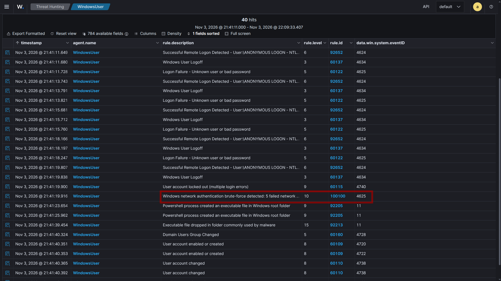
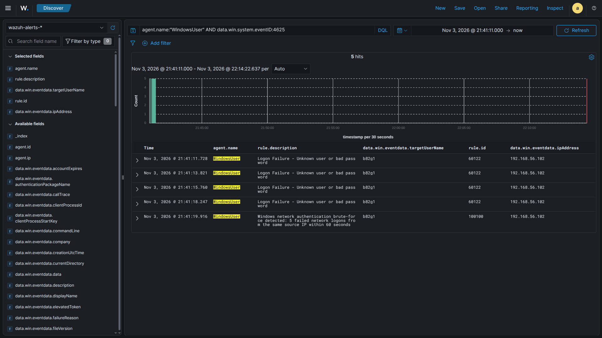
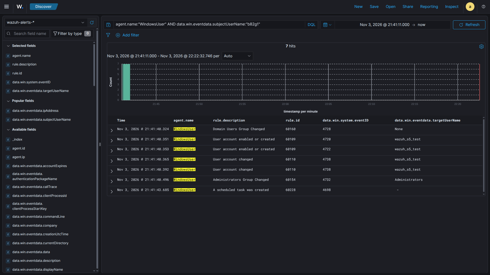
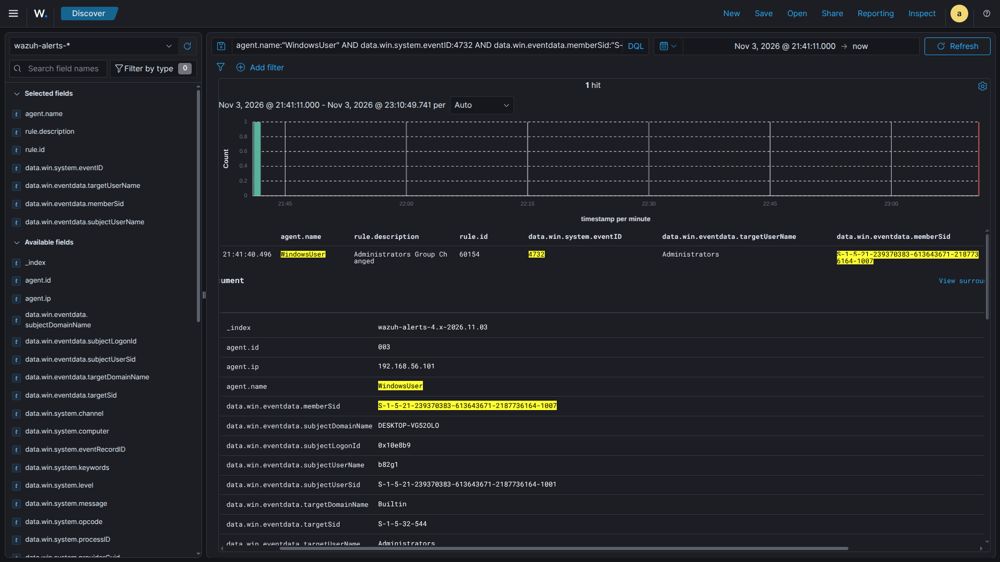
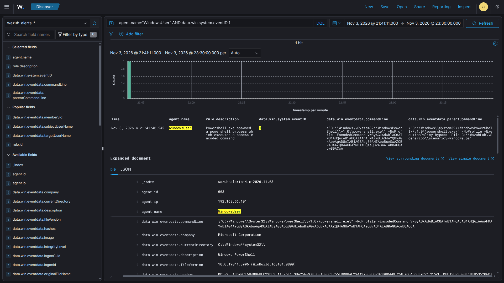
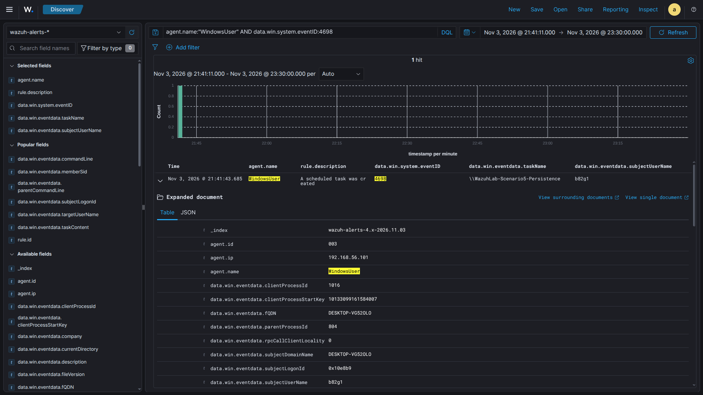

# Capstone Investigation — End-to-End Incident Analysis

## 1. Overview

This scenario is the capstone of the homelab project. It brings together the attack techniques and detection capabilities demonstrated in the previous scenarios into one coordinated incident simulation.

The earlier scenarios focused on individual techniques, including SMB brute-force attempts, encoded PowerShell execution, local account creation, and modifications to local Administrators group membership. This final scenario combines these activities and adds scheduled task registration to demonstrate how multiple security events can be investigated together.

The objective is to demonstrate an end-to-end security investigation using Wazuh, Windows Security auditing, and Sysmon. Rather than examining each alert in isolation, the investigation follows the available evidence through authentication activity, account manipulation, privilege escalation, process execution, and scheduled task registration.

The scenario covers five activity stages:

1. Repeated SMB authentication failures.
2. Creation of a local user account.
3. Addition of that account to the local Administrators group.
4. Execution of an encoded PowerShell command.
5. Registration of a scheduled task as a persistence simulation.

**Environment**

| Component | Details |
|---|---|
| SIEM | Wazuh |
| Monitored endpoint | WindowsUser |
| Windows agent ID | `003` |
| Windows agent IP | `192.168.56.101` |
| Kali attacker/test VM | `192.168.56.102` |
| Windows account involved | `b82g1` |
| Temporary account | `wazuh_s5_test` |
| Incident date | November 3, 2026 |

All activity was performed in an isolated lab environment. The commands and payloads used in this scenario were controlled test actions, not an attempt to compromise a real system.

## 2. Investigation Objectives

The scenario was designed to demonstrate:

- Detection of repeated failed SMB authentication attempts.
- Collecting Windows account-management events.
- Detecting changes to local Administrators group membership.
- Identifying encoded PowerShell execution through Sysmon.
- Detecting scheduled task registration.
- Providing enough event metadata to correlate activity by account, SID, Logon ID, process information, and timestamp.

## 3. Incident Simulation

The Windows endpoint was monitored by the Wazuh agent. Kali Linux was used to generate the SMB authentication failures, while the remaining activity was performed through a controlled PowerShell script on Windows.

The Windows script performed the following actions:

1. Created `wazuh_s5_test`.
2. Added `wazuh_s5_test` to the local Administrators group.
3. Started a child PowerShell process using `-EncodedCommand`.
4. Registered the scheduled task `WazuhLab-Scenario5-Persistence`.

The encoded command was harmless:

```powershell
Write-Output 'Scenario 5 controlled execution test'
```

The scheduled task was configured with the action:

```text
cmd.exe /c echo Scenario5
```

The task was registered but deliberately not executed.

---

# 4. Investigation Walkthrough

## 4.1 Initial Detection — Threat Hunting

The investigation begins in Wazuh Threat Hunting, where custom rule `100100` provides the primary detection of interest.

This custom rule was configured to identify repeated failed SMB authentication attempts. It generated a level 10 alert on the monitored endpoint `WindowsUser` at approximately 21:41 on November 3, 2026.

The alert is the initial trigger for the investigation because it indicates a burst of failed network authentication attempts against the Windows endpoint.



**Custom rule 100100 identifies repeated SMB authentication failures in Threat Hunting.**

Although rule `100100` is the main focus at this stage, it is not the only alert worth examining. Threat Hunting also provides visibility into other suspicious activity detected on the endpoint. These additional alerts can offer useful investigative leads and help build a broader picture of what happened during the incident window.

The initial detection establishes two priorities:

- Investigate the underlying authentication failures that triggered custom rule `100100`.
- Keep the other suspicious alerts in view as potential indicators of related activity.

The aggregated alert alone does not provide enough detail to understand the individual authentication attempts. The next step is to inspect the underlying Windows events and identify the targeted account, source address, and logon type.

## 4.2 Authentication Investigation — SMB Failures

The next step is to inspect the underlying Windows Security events.

Discover is used to examine Event ID `4625`, which records failed logon attempts. The query limits the results to the affected Windows endpoint:

```text
agent.name:"WindowsUser" AND data.win.system.eventID:4625
```

The results contain five matching authentication failures:

- Four individual alerts generated by Wazuh rule `60122`, level 5.
- One aggregated alert generated by custom rule `100100`, level 10.

The events show the following relevant information:

| Field | Observed value |
|---|---|
| Target account | `b82g1` |
| Source IP | `192.168.56.102` |
| Logon type | `3` |
| Windows Event ID | `4625` |
| Individual Wazuh rule | `60122` |
| Custom aggregation rule | `100100` |

Logon Type 3 indicates a network logon. The source address corresponds to the Kali test VM, which generated the failed SMB authentication attempts.



**Underlying failed network logons targeting b82g1.**

The five failures establish that repeated authentication attempts were directed at the account `b82g1` from the Kali VM.

At this stage, it is important not to assume that the attempts resulted in access. Event ID 4625 records failed authentication, not successful authentication. The available evidence does not establish that these attempts created an authenticated SMB session.

The investigation therefore moves beyond the authentication events and examines other activity involving the targeted account.

## 4.3 Identity Pivot — Activity Associated with b82g1

The authentication events identify `b82g1` as the targeted account. This provides a useful pivot point.

Instead of immediately searching for a particular Windows event ID, the investigation expands to activity associated with the same identity. After identifying an account of interest, examining what else that account did on the endpoint during the incident window can reveal additional security-relevant events.

The Discover query is:

```text
agent.name:"WindowsUser" AND
data.win.eventdata.subjectUserName:"b82g1"
```

The results reveal a cluster of seven events around 21:41:40–21:41:43.

| Approximate time | Wazuh rule | Description | Windows Event ID |
|---|---|---|---|
| 21:41:40.324 | 60160 | Domain Users Group Changed | 4728 |
| 21:41:40.351 | 60109 | User account enabled or created | 4720 |
| 21:41:40.353 | 60109 | User account enabled or created | 4722 |
| 21:41:40.365 | 60110 | User account changed | 4738 |
| 21:41:40.392 | 60110 | User account changed | 4738 |
| 21:41:40.496 | 60154 | Administrators Group Changed | 4732 |
| 21:41:43.685 | 60228 | A scheduled task was created | 4698 |

The identity pivot reveals that the account associated with the earlier authentication investigation also appears as the subject of account-management and scheduled-task events.



**Events associated with b82g1 reveal a concentrated cluster of account and system changes.**

Several investigative leads are now visible. The most significant are the creation of a new local account and the subsequent change to the Administrators group.

The next step is to determine whether the newly created account is the same account that was granted administrative privileges. Further examination of Windows security identifiers is required rather than just relying only on account names.

## 4.4 Account Creation and Privilege Escalation

### Account creation — Event ID 4720

The first relevant event is Windows Security Event ID `4720`, which records the creation of a user account.

The event identifies:

| Field | Observed value |
|---|---|
| Creating account | `b82g1` |
| Created account | `wazuh_s5_test` |
| Windows Event ID | `4720` |
| Wazuh rule | `60109` |
| Wazuh level | `8` |
| New account SID | `S-1-5-21-239370383-613643671-2187736164-1007` |
| Subject Logon ID | `0x10e8b9` |

The event establishes that `b82g1` created the temporary local account `wazuh_s5_test`.

The new account SID is especially important. Unlike an account name, a SID provides a unique security identifier that can be compared against subsequent Windows security events.

### Administrator group membership — Event ID 4732

After identifying the newly created account, the next step is to investigate the Administrators group change.

Windows Security Event ID `4732` records the addition of a member to a security-enabled local group.

The relevant event fields are:

| Field | Observed value |
|---|---|
| Actor | `b82g1` |
| Subject Logon ID | `0x10e8b9` |
| Target group | `Administrators` |
| Target group SID | `S-1-5-32-544` |
| Member SID | `S-1-5-21-239370383-613643671-2187736164-1007` |
| Windows Event ID | `4732` |
| Wazuh rule | `60154` |
| Wazuh level | `12` |

The member SID in Event 4732 exactly matches the SID assigned to `wazuh_s5_test` in Event 4720.

The two events also share the subject Logon ID `0x10e8b9` and identify `b82g1` as the actor.

This is a direct correlation:

- Event 4720 identifies the SID of the newly created account.
- Event 4732 shows that the same SID was added to the built-in Administrators group.
- Both events identify the same actor and Logon ID.

The Windows message does not resolve the member account name in Event 4732, but the matching SID establishes the identity of the added account.



**Matching the new account SID to the member SID in the Administrators group-change event.**

The evidence confirms that `wazuh_s5_test` was added to the local Administrators group. This is the privilege-escalation stage of the simulation.

With account creation and group membership established, the investigation is leading towards stronger evidence of a potential adversary. Next is to determine whether suspicious execution occurred during the same activity.

## 4.5 Suspicious Execution — Encoded PowerShell

After confirming that the newly created account was added to the local Administrators group, the investigation continues through the same suspicious activity cluster.

The next question is whether the activity was accompanied by suspicious process execution.

Encoded PowerShell is relevant to investigate because the `-EncodedCommand` parameter allows a command to be supplied in Base64-encoded form rather than appearing as ordinary readable PowerShell instructions in the process command line.

The initial search attempts to narrow the investigation to Sysmon Process Creation events containing the encoded-command parameter:

```text
agent.name:"WindowsUser" AND
data.win.system.eventID:1 AND
data.win.eventdata.commandLine:"*-EncodedCommand*"
```

This exact field-level query does not return an event, therefore the search is broadened to all Sysmon Process Creation events on the affected endpoint:

```text
agent.name:"WindowsUser" AND data.win.system.eventID:1
```

Inspection of its full JSON confirms that the command line contains `-EncodedCommand`.

### Process creation evidence

The matching Sysmon event contains the following information:

| Field | Observed value |
|---|---|
| Windows Event ID | `1` |
| Wazuh rule | `92057` |
| Wazuh level | `12` |
| Detection description | PowerShell.exe spawned a PowerShell process which executed a Base64-encoded command |
| Execution account | `DESKTOP-VG52OLO\b82g1` |
| Process ID | `4244` |
| Parent process ID | `8776` |
| Integrity level | `High` |
| Logon ID | `0x10e8b9` |
| Process image | `powershell.exe` |
| Parent image | `powershell.exe` |

The process command line includes:

```powershell
-NoProfile -EncodedCommand VwByAGkAdABlAC0ATwB1AHQAcAB1AHQAIAAnAFMAYwBlAG4AYQByAGkAbwAgADUAIABjAG8AbgB0AHIAbwBsAGwAZQBkACAAZQB4AGUAYwB1AHQAaQBvAG4AIAB0AGUAcwB0ACcA
```

Decoding the Base64 content produces:

```powershell
Write-Output 'Scenario 5 controlled execution test'
```

The event also contains the parent command line:

```text
"C:\Windows\System32\WindowsPowerShell\v1.0\powershell.exe" -NoProfile -ExecutionPolicy Bypass -File C:\WazuhLab\Scenario5\scenario5-windows.ps1
```

The Scenario 5 script as the parent process is responsible for launching the encoded PowerShell child process.

Two correlations:

1. The process executed under `b82g1`, which is the same account identified in the account creation and Administrators group membership events.
2. The process Logon ID is `0x10e8b9`, matching the Logon ID in those earlier Windows Security events.

The process therefore belongs to the same user logon context as the account manipulation events.

However, the process did not run as `wazuh_s5_test`. It ran under the existing account `b82g1`. The temporary account was created and added to Administrators, but the PowerShell process metadata does not show that account as its execution identity.



**Sysmon Process Create event showing the encoded PowerShell command, execution identity, and parent script.**

Wazuh rule `92057` detected the encoded PowerShell execution and mapped it to MITRE ATT&CK technique `T1059.001` — PowerShell.

The provided telemetry shows that an execution pattern like this one can be easily identified, especially with weak evasion methods. In this instance the command used was harmless.

## 4.6 Persistence Attempt — Scheduled Task Registration

After confirming encoded PowerShell execution, the investigation moves to the possibility of persistence.

A scheduled task can be registered to execute a program or command under a configured security principal. Event ID `4698` records scheduled task creation, making it relevant to this investigation.

Discover is used to search for scheduled task creation events:

```text
agent.name:"WindowsUser" AND data.win.system.eventID:4698
```

The returned event confirms that Windows successfully registered the task.

### Scheduled task evidence

| Field | Observed value |
|---|---|
| Windows Event ID | `4698` |
| Wazuh rule | `60228` |
| Wazuh level | `4` |
| Rule description | A scheduled task was created |
| Task name | `\WazuhLab-Scenario5-Persistence` |
| Creating account | `b82g1` |
| Subject Logon ID | `0x10e8b9` |
| Configured task principal | `wazuh_s5_test` |
| Configured run level | `HighestAvailable` |
| Configured action | `cmd.exe /c echo Scenario5` |
| Event time | 21:41:43.685 |

The task XML contains the following principal configuration:

```xml
<Principal id="Author">
    <UserId>wazuh_s5_test</UserId>
    <LogonType>InteractiveToken</LogonType>
    <RunLevel>HighestAvailable</RunLevel>
</Principal>
```

The action is:

```xml
<Exec>
    <Command>cmd.exe</Command>
    <Arguments>/c echo Scenario5</Arguments>
</Exec>
```

The event identifies `b82g1` as the account that registered the task. Its subject Logon ID is again `0x10e8b9`, matching the account creation, group membership, and PowerShell process events.

The task XML also identifies `wazuh_s5_test` as the configured principal, linking the task configuration to the account created earlier in the scenario.



**Windows Event 4698 showing task registration, creator identity, Logon ID, and configured task principal.**

This event confirms successful task registration. It was not established that the task executed or that it achieved persistence through a subsequent execution.

Wazuh rule `60228` mapped the event to MITRE ATT&CK technique `T1053` — Scheduled Task/Job.

---

# 5. Reconstructed Incident Timeline

The following timeline consolidates the observed events from the investigation.

| Date and time (local) | Activity | Event / Wazuh rule |
|---|---|---|
| Nov 3, 21:41:00 approximately | Custom SMB brute-force detection | Rule `100100` |
| Nov 3, 21:41:11–21:41:19 | Five failed SMB authentication attempts | Event `4625`, rule `60122` |
| Nov 3, 21:41:40.351 | Temporary local account created | Event `4720`, rule `60109` |
| Nov 3, 21:41:40.496 | Temporary account added to Administrators | Event `4732`, rule `60154` |
| Nov 3, 21:41:40.942 | Encoded PowerShell process created | Sysmon Event `1`, rule `92057` |
| Nov 3, 21:41:43.685 | Scheduled task registered | Event `4698`, rule `60228` |

The account creation, Administrators group change, PowerShell process creation, and scheduled task registration occurred within approximately four seconds.

## 6. Correlation Analysis

Several relationships between events were identified during the investigation.

### 6.1 Account creation and privilege escalation

Event 4720 records the creation of `wazuh_s5_test` and assigns it the SID:

```text
S-1-5-21-239370383-613643671-2187736164-1007
```

Event 4732 records that this exact SID was added to the local Administrators group.

Both events identify `b82g1` as the actor and share Logon ID `0x10e8b9`.

### 6.2 Privilege escalation and encoded PowerShell

The Sysmon process creation event identifies:

```text
User: DESKTOP-VG52OLO\b82g1
LogonId: 0x10e8b9
```

These values match the actor and Logon ID recorded in the account creation and group membership events.

This supports the conclusion that the encoded PowerShell process was launched within the same user logon context, however, it does not show that the newly created account executed the process.

### 6.3 Encoded PowerShell and scheduled task registration

The scheduled task creation event identifies:

```text
SubjectUserName: b82g1
SubjectLogonId: 0x10e8b9
```

These values match the Sysmon process event and the earlier account-management events.

Registration has been proven, with no execution cues.


### 6.4 SMB failures and subsequent account manipulation

The five SMB authentication failures targeted `b82g1` from `192.168.56.102`. Account creation and the other actions occurred shortly afterward.

However, the available evidence does not establish a successful SMB authentication or an authenticated session connecting the failed attempts to the subsequent actions.

The events are part of the same controlled scenario and appear in chronological order, but the report does not claim that the SMB attempts caused the account creation or that they provided initial access.

---

# 7. MITRE ATT&CK Mapping

The observed detections map to the following ATT&CK techniques:

| Activity | MITRE ATT&CK technique | Technique ID | Evidence |
|---|---|---|---|
| Repeated authentication failures | Brute Force | `T1110` | Custom rule `100100` |
| Local account creation and manipulation | Account Manipulation | `T1098` | Event `4720`, rule `60109` |
| Encoded PowerShell execution | PowerShell | `T1059.001` | Sysmon Event `1`, rule `92057` |
| Scheduled task registration | Scheduled Task/Job | `T1053` | Event `4698`, rule `60228` |

These mappings describe the techniques associated with the observed behavior. They do not independently establish malicious intent or successful compromise.

---

# 8. Detection Coverage and Results

| Detection objective | Windows / Sysmon event | Wazuh rule | Result |
|---|---|---|---|
| Repeated failed SMB authentication | 4625 | 60122 / 100100 | Detected |
| Local account creation | 4720 | 60109 | Detected |
| Administrators group membership change | 4732 | 60154 | Detected |
| Encoded PowerShell process creation | Sysmon 1 | 92057 | Detected |
| Scheduled task registration | 4698 | 60228 | Detected |

---

# 9. Recommendations

Based on the events observed during the investigation, the following security improvements are recommended:

1. **Strengthen authentication controls:** Implement account lockout thresholds and monitoring for repeated failed authentication attempts.
2. **Restrict administrative privileges:** Limit membership of the local Administrators group to explicitly authorized accounts.
3. **Monitor local account creation:** Alert on unexpected local account creation and review the account's creator assigned privileges, and new activity.
4. **Strengthen Powershell monitoring:** Continue monitoring Sysmon Process Creation events for suspicious commands. Investigate the command line, parent process, execution account, and associated process identifiers to distinguish legitimate administrative activity from suspicious execution. 
5. **Control scheduled task registration:** Restrict who can create scheduled tasks and monitor Event ID 4698 for unexpected task registrations. Review the task's creator, execution principal, configured privileges, triggers, and action. 
6. **Correlate related endpoint events:** Use shared identifiers and event attributes, such as account SIDs, Logon IDs, usernames, and timestamps, to connect account creation, privilege changes, process execution and scheduled task registration.
7. **Preserve endpoint telemetry.** Retain Windows Security and Sysmon logs so investigations can reconstruct activity after an alert.

For this lab, the Windows firewall was disabled as part of the isolated testing configuration. In real time configuration, it should be enabled.
